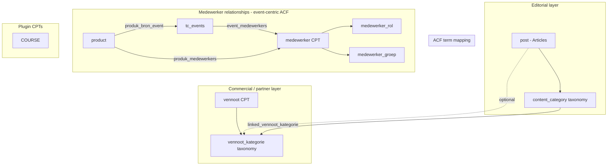

# Voelgoed Platform (vgnova)

Documentation for the **Voelgoed** WordPress staging site managed through **Novamira** in Cursor. This repo is the agent/docs workspace; the live site runs on Local (currently `http://localhost:10039`).

**Related docs:** [`AGENTS.md`](./AGENTS.md) (agent rules and architecture) · [`docs/development/medewerkers-admin-workflow.md`](./docs/development/medewerkers-admin-workflow.md) (people / events / products) · [`docs/development/Voelgoed-Featured-Content-Zero-Code.md`](./docs/development/Voelgoed-Featured-Content-Zero-Code.md) (featured content in Bricks)

**Last inspected:** 5 June 2026 (via Novamira MCP against staging)

---

## Table of contents

1. [What this project is](#what-this-project-is)
2. [Environment & stack](#environment--stack)
3. [URL structure (`/content`, `/leer`, `/winkel`, `/events`)](#url-structure-content-leer-winkel-events)
4. [Content model overview](#content-model-overview)
5. [Custom post types (ACF)](#custom-post-types-acf)
6. [Taxonomies (ACF)](#taxonomies-acf)
7. [Content categories & subcategories](#content-categories--subcategories)
8. [ACF field groups](#acf-field-groups)
9. [Medewerker relationships](#medewerker-relationships-mvp)
10. [Vennote & `vennoot_kategorie`](#vennote--vennoot_kategorie)
11. [Taxonomy links (editorial ↔ commercial)](#taxonomy-links-editorial--commercial)
12. [Featured content (options page)](#featured-content-options-page)
13. [Bricks templates & components](#bricks-templates--components)
14. [Plugin-owned content types](#plugin-owned-content-types)
15. [Options pages & global settings](#options-pages--global-settings)
16. [How to work on this site](#how-to-work-on-this-site)
17. [Known gaps & quirks](#known-gaps--quirks)

---

## What this project is

Voelgoed is an Afrikaans women's wellness platform being rebuilt as **one Bricks-based WordPress site**, consolidating content from three legacy sites (articles, LearnDash courses, WooCommerce shop). Staging is the source of truth for structure; this folder holds **plans, backups, and agent guidance**—not the WordPress codebase itself (that lives in Local's `app/public`).

**Non-negotiables (see `AGENTS.md`):**

- **ACF Pro** registers all custom CPTs, taxonomies, and field groups
- **FluentSnippets** for custom PHP/JS/CSS — published snippets on staging include product cards, taxonomy helpers, maintenance, and **`9-acf-product-copy.php`** (medewerker auto-fill on products)
- **Bricks + ACSS** for front-end; prefer native/plugin UI over code

---

## Environment & stack

| Layer | Tool | Role |
|--------|------|------|
| CMS | WordPress 7.0 | Core |
| Builder | Bricks 2.3.5 + child theme | Templates, components, layouts |
| Design system | Automatic.css (ACSS) 4.x | Tokens, utilities |
| Fields / CPTs | ACF Pro 6.8.1 | All custom types and relationships |
| LMS | **Masteriyo** (`mto-course`) | Courses (replaces LearnDash on this install) |
| Shop | WooCommerce 10.x | Products |
| Events / tickets | **Tickera** (`tc_events`) | Events and ticketing |
| Membership | Paid Memberships Pro | Gating (configured; not detailed here) |
| CRM / forms | FluentCRM, Fluent Forms | Newsletter, automations |
| Agent bridge | Novamira + Novamira Pro | Inspection and changes from Cursor |

**Staging URL:** `http://localhost:10039`  
**DB backup in repo:** `docs/backups/backup-pre-cleanup-20260528.sql`

---

## URL structure (`/content`, `/leer`, `/winkel`, `/events`)

Permalinks are split between **WordPress settings**, **ACF CPT rewrite rules**, and **WooCommerce/Masteriyo** settings. Use the table below for routing—not every “marketing” path has a matching WordPress page slug.

### Quick reference

| Area | Singles (example) | Archive / hub | Notes |
|------|-------------------|---------------|--------|
| **Articles** (`post`) | `/content/{slug}/` | No dedicated `/content/` archive | Global permalink structure: `/content/%postname%/` |
| **Courses** (`mto-course`) | `/leer/{slug}/` | `/kursusse/` | CPT rewrite slug = `leer`; archive slug = `kursusse` (page “Course Catalog”, ID 57) |
| **Products** (`product`) | `/winkel/{slug}/` | `/produkte/` | WooCommerce `product_base` = `/winkel`; shop page slug = `produkte` |
| **Events** (`tc_events`) | `/events/{slug}/` | `/events/` | Tickera events CPT |
| **Medewerkers** (`medewerker`) | `/medewerkers/{slug}/` | `/medewerkers/` | ACF CPT — public people/contributors |
| **Voelgoed Live** (`uitsending`) | `/voelgoed-live/{slug}/` | `/voelgoed-live/` | ACF CPT; internal key stays `uitsending` |
| **Competitions** (`kompetisie`) | `/kompetisie/{slug}/` | `/kompetisie/` | Hierarchical CPT |
| **Partners** (`vennoot`) | `/content/vennoot/{slug}/` | None | `with_front: true` on CPT—URLs sit under the `/content/` prefix today |
| **Content category** (taxonomy) | — | `/content_category/{slug}/` | e.g. `/content_category/nuwe-jy/` |

### How each hub works

#### `/content` — articles

- **Settings → Permalinks:** structure is `/content/%postname%/`.
- Articles are standard `post` type with taxonomy `content_category` for pillars.
- There is **no** published page with slug `content` and **no** post type archive for `post`; a site-wide article index would be a **Bricks page or taxonomy archive**, not `/content/` by default.

#### `/leer` — courses

- **Single course URLs** use the Masteriyo/ACF rewrite slug **`leer`**: e.g. `/leer/mindfulness-vroue/`.
- **Course catalog** resolves to the **post type archive** `kursusse`, backed by the page “Course Catalog” (`/kursusse/`). Masteriyo also has a “Learn” page at `/learn/` for LMS flows (account, lessons)—distinct from the public catalog slug.

#### `/winkel` — shop products

- **Single product URLs** use WooCommerce base **`/winkel`**: e.g. `/winkel/slaapmasker-deluxe/`.
- **Shop archive** is the WooCommerce shop page at **`/produkte/`** (slug `produkte`, title “Shop”)—not `/winkel/`. Product categories use base `produk-kategorie`.

#### `/events` — Tickera events

- **Singles and archive** both use slug **`events`**: e.g. `/events/weekend-drakensberg/`, archive `/events/`.
- Event **type** in the editorial sense is taxonomy **`event_category`** (8 terms configured—see below), not a separate `event` CPT.

#### `/voelgoed-live` — Voelgoed Live

- **Single episode URLs** use the ACF CPT rewrite slug **`voelgoed-live`**: e.g. `/voelgoed-live/rustige-oggend-asemhaling-gebed/`.
- The internal CPT key remains **`uitsending`** so existing posts, ACF locations, and Bricks conditions stay stable.
- Series are stored in taxonomy **`uitsending_series`**, labeled **Voelgoed Live Reekse**, with public URLs under `/voelgoed-live/reeks/{series}/`.
- Formats are stored in taxonomy **`uitsending_type`**, labeled **Voelgoed Live Formate**, with public URLs under `/voelgoed-live/formaat/{format}/`.
- Canonical series: `Twintig-Twintig` (`twintig-twintig`), `#MentorMaandag` (`mentor-maandag`), `#WebinaarWoensdag` (`webinaar-woensdag`).

---

## Content model overview



**Design principle:** People are linked via the **`medewerker`** CPT and event/product relationship fields (`event_medewerkers`, `produk_bron_event`, `produk_medewerkers`). Editorial categories are **not** used to link people or sponsors—`content_category` is for pillars and filtering; partner placement uses `vennoot_kategorie` + mapping fields. See [Medewerkers admin workflow](docs/development/medewerkers-admin-workflow.md).

---

## Custom post types (ACF)

Registered in **ACF → Post Types** (all `source: db`).

| Slug | Admin label | Public archive | Rewrite slug | Taxonomies (selected) |
|------|-------------|----------------|--------------|------------------------|
| `medewerker` | Medewerkers | Yes → `/medewerkers/` | `medewerkers` | `medewerker_rol`, `medewerker_groep` |
| `uitsending` | Voelgoed Live | Yes → `/voelgoed-live/` | `voelgoed-live` | `content_category`, `uitsending_series`, `uitsending_type` |
| `kompetisie` | Kompetisies | Yes → `/kompetisie/` | `kompetisie` | `content_category`, `kompetisie_type` |
| `kompetisie_entry` | Kompetisie Inskrywings | No | `inskrywing` | (via parent field) |
| `team_member` | Our Team | No | default | `content_category`, `team_department` |
| `testimonial` | Testimonials | No | default | `content_category` |
| `vennoot` | Vennote | No | inherits front → under `/content/` | `vennoot_kategorie` |

**Publish counts (staging snapshot):** posts 8 · products 5 · courses 5 · events 13 · medewerkers 5 · Voelgoed Live episodes 5 · vennote 2 · kompetisies 0

### Plugin CPTs (not ACF)

| Slug | Plugin | Archive / rewrite |
|------|--------|-------------------|
| `mto-course` | Masteriyo | Archive `kursusse`, single slug `leer` |
| `product` | WooCommerce | Shop `/produkte/`, single base `/winkel` |
| `tc_events` | Tickera | `/events/` |

`AGENTS.md` is aligned with staging for events (`tc_events`), courses (Masteriyo), and medewerkers. Source-site migration from LearnDash is historical context only.

---

## Taxonomies (ACF)

| Slug | Label | Hierarchical | Attached to |
|------|-------|--------------|-------------|
| `content_category` | Content Categories | **Yes** | `post`, `product`, `tc_events`, `mto-course`, `medewerker`, `uitsending`, `kompetisie`, `kompetisie_entry`, `testimonial`, `team_member` |
| `medewerker_rol` | Medewerkerrolle | No | `medewerker` |
| `medewerker_groep` | Medewerkergroepe | **Yes** | `medewerker` |
| `vennoot_kategorie` | Vennoot Kategorieë | Yes | `vennoot`, **`post`**, **`page`** |
| `event_category` | (Tickera / site) | — | Events (8 terms) |
| `kompetisie_type` | Kompetisie Type | — | `kompetisie`, `kompetisie_entry` |
| `uitsending_series` | Voelgoed Live Reekse | — | `uitsending` |
| `uitsending_type` | Voelgoed Live Formate | — | `uitsending` |
| `team_department` | Department | — | `team_member` |

**Rewrite:** `content_category` → `/content_category/{term}/` (`with_front: false`). Voelgoed Live series use `/voelgoed-live/reeks/{term}/`; Voelgoed Live formats use `/voelgoed-live/formaat/{term}/`.

### Medewerkerrolle (`medewerker_rol`)

Non-hierarchical; one profile can have multiple roles:

`aanbieder` · `fasiliteerder` · `gas` · `kenner` · `kunstenaar` · `mentor` · `paneellid` · `skrywer` · `spreker`

The term slug **`mentor`** is a **role label only** — not the old `mentor` CPT.

### Medewerkergroepe (`medewerker_groep`)

Hierarchical grouping for editorial/brand context:

| Slug | Name |
|------|------|
| `voelgoed-mentor` | Voelgoed Mentor |
| `voelgoed-kenner` | Kenner |
| `event-spreker` | Event Spreker |
| `bekende` | Bekende |
| `voelgoed-live-gas` | Voelgoed Live Gas |

---

## Content categories & subcategories

### Eight editorial pillars (architecture target)

These are the primary Voelgoed content pillars from `AGENTS.md`:

| Slug | Name | Articles assigned (staging) |
|------|------|----------------------------|
| `nuwe-jy` | Nuwe Jy | 1 |
| `geloof` | Geloof | 1 |
| `self` | Self | 1 |
| `werk-geld` | Werk + Geld | 1 |
| `ouerskap` | Ouerskap | 1 |
| `huwelik` | Huwelik | 0 |
| `mensstories` | Mensstories | 1 |
| `leefstyl` | Leefstyl | 0 |

### Additional `content_category` terms (partner / lane labels)

These exist on staging as **top-level** terms (no child terms in use yet—`parent: 0` for all). Several map to `vennoot_kategorie` via ACF (see [Taxonomy links](#taxonomy-links-editorial--commercial)):

| Slug | Name | Linked `vennoot_kategorie` |
|------|------|---------------------------|
| `doen-goed` | Doen Goed | `doen-goed` |
| `finansies-vennoot` | Finansies Vennote | `finansies` |
| `natuurlik-gesond` | Natuurlik Gesond | `natuurlik-gesond` |
| `aanlyn-onderwys` | Aanlyn Onderwys | — |
| `vakansie-vennoot` | Vakansie Vennote | — |

### Subcategories

- Taxonomy is **hierarchical** (parent/child supported in ACF).
- **No child terms** are configured on staging (`content_category_children` option is empty).
- Subcategory URLs would be `/content_category/{child-slug}/` once children are created under a parent pillar.

### `event_category` (Tickera — event “types”)

Eight terms group events (counts on staging):

| Slug | Label (short) |
|------|----------------|
| `aanlyn` | Aanlyn, Voelgoed Live … |
| `feeste` | Feeste, markte … |
| `funksies` | Funksies, vroue-oggende … |
| `vertonings` | Vertonings, produksies … |
| `werkswinkels` | Werkswinkels, praatjies … |
| `reise` | Reise, toere … |
| `sport` | Sport, gholfdae … |
| `kompetisies` | Donasies, kompetisies … |

---

## ACF field groups

All groups are in **ACF → Field Groups** unless noted.

**Naming on staging:** Field names use `[context]_[purpose]` (e.g. `medewerker_kort_bio`, `event_medewerkers`). Admin labels use a context prefix (e.g. **Medewerker: Kort bio**, **Site: Email** on global options). Avoid generic names like `bio` or `status` without a domain prefix.

### Articles & pages

| Group | Location | Fields (name → type) |
|-------|----------|----------------------|
| **Content — Article** | `post` | `article_lede` (textarea), `article_read_time` (number) |
| **Partner Display Override** | `post`, `page` | `manual_vennoot` (post object → `vennoot`), `hide_vennoot_blok` (true/false) |

### Medewerkers (people, events, products)

| Group | Location | Fields |
|-------|----------|--------|
| **Medewerker Besonderhede** | `medewerker` | `medewerker_titel`, `medewerker_kort_bio`, `medewerker_profiel_status` — labels **Medewerker: Titel**, **Medewerker: Kort bio**, **Medewerker: Profielstatus** |
| **Event Medewerkers** | `tc_events` | `event_medewerkers` (relationship → `medewerker`, Post ID) |
| **Medewerker Produkte** | `product` | `produk_bron_event` (post object → `tc_events`), `produk_medewerkers` (relationship → `medewerker`) |

Admin workflow: [docs/development/medewerkers-admin-workflow.md](docs/development/medewerkers-admin-workflow.md). Product auto-fill: FluentSnippets `9-acf-product-copy.php`.

### Partners (Vennote)

| Group | Location | Fields |
|-------|----------|--------|
| **Vennoot Besonderhede** | `vennoot` | `vennoot_logo` (image), `vennoot_short_description`, `vennoot_url`, `vennoot_status` (`active` \| `paused` \| `expired`) |
| **Kategorie Vennoot Mapping** | `content_category` **term** | `linked_vennoot_kategorie` (taxonomy select → `vennoot_kategorie`, optional) |

### Competitions, team, testimonials

| Group | Location | Fields |
|-------|----------|--------|
| **Kompetisie Inskrywing — Parent** | `kompetisie_entry` | `parent_kompetisie` (post object → `kompetisie`, required) |
| **Team Member — Profile** | `team_member` | 12 fields (profile details) |
| **Testimonial — Details** | `testimonial` | 10 fields |

### Disabled / superseded

| Group | Status | Notes |
|-------|--------|--------|
| **Content Category — Sidebar Promo** | **Inactive** | Superseded by Featured Content Manager + Bricks |

### Global options field groups

| Group | Options page | Purpose |
|-------|----------------|---------|
| **Company & Brand** | `vg-company` | 22 fields — brand, contact, social. Admin labels prefixed **Site:** (e.g. Site: Company / Site Name, Site: Email). Field names unchanged (`company_name`, `contact_email`, `logo_light`, …). |
| **Newsletter & CTAs** | `vg-newsletter` | 18 fields — headings, Fluent Forms copy, messages |
| **Featured Content Manager** | `featured-content-manager` | 7 pillar pickers (see below) |

---

## Medewerker relationships (MVP)

Staging uses a **fresh rebuild** people model: one CPT for all public contributors. There is **no** `mentor` post type, no legacy mentor ACF groups, and **no** `/mentor/` redirects (`/mentor/` returns 404).

### Data model

| Field | On | Points to |
|-------|-----|-----------|
| `event_medewerkers` | `tc_events` | `medewerker` (multiple, Post ID) |
| `produk_bron_event` | `product` | `tc_events` (single, Post ID) |
| `produk_medewerkers` | `product` | `medewerker` (multiple, Post ID) |

Profile fields on `medewerker`: `medewerker_titel`, `medewerker_kort_bio`, `medewerker_profiel_status`.

### Editor flow (summary)

1. Create **Medewerker** (name, image, bio) → assign **Medewerkerrolle** and **Medewerkergroep**.
2. On the **event** (`tc_events`), select **Event Medewerkers**.
3. Create a **product** for the recording → set **Bron Event** (`produk_bron_event`).
4. Set **Produk Medewerkers** manually, or leave empty: on save, FluentSnippets **`9-acf-product-copy.php`** copies from the event’s `event_medewerkers` (never overwrites an existing selection).

Full workflow: [`docs/development/medewerkers-admin-workflow.md`](./docs/development/medewerkers-admin-workflow.md).

### Public URLs

- Archive: `/medewerkers/`
- Profile: `/medewerkers/{slug}/`

### Bricks (shipped)

- **Medewerker Single** (772), **Medewerker Archive** (773), **Event Single** (774 medewerker loop), **Single Product** (124 medewerker loop); component **Medewerker Card** (`6b463f`).
- Profile/card dynamic tags: `{acf_medewerker_titel}`, `{acf_medewerker_kort_bio}`.
- Deprecated **Mentor** Bricks template (342) was trashed; use *Medewerker Single* (772) only.

---

## Vennote & `vennoot_kategorie`

### Concepts

| Piece | What it is |
|-------|------------|
| **`vennoot` CPT** | A sponsor/partner record (logo, blurb, URL, status) |
| **`vennoot_kategorie` taxonomy** | Commercial “partner lane” (Finansies, Doen Goed, …)—assigned to **vennote** and optionally to **posts/pages** |
| **`content_category`** | Editorial pillar/lane—stays editorial; can **map** to a partner lane without merging taxonomies |

### `vennoot_kategorie` terms (staging)

| Slug | Name | Vennote using it |
|------|------|------------------|
| `finansies` | Finansies | Eksekuteurs, Everest Wealth |
| `geldgeheime` | Geldgeheime | Everest Wealth |
| `doen-goed` | Doen Goed | — |
| `natuurlik-gesond` | Natuurlik Gesond | — |
| `onderwys` | Onderwys | — |
| `vakansie` | Vakansie | — |

### Partner records (staging)

| Title | Slug | Status | Categories |
|-------|------|--------|------------|
| Eksekuteurs | `eksekuteurs` | active | finansies |
| Everest Wealth | `everest-wealth` | active | finansies, geldgeheime |

### How display is intended to work

1. **Default (future Bricks blocks):** Resolve partner(s) from the current post’s `content_category` term(s) → read term meta **`linked_vennoot_kategorie`** → query `vennoot` posts with matching `vennoot_kategorie`.
2. **Direct assignment:** Assign `vennoot_kategorie` terms on a `post` or `page` when needed (taxonomy is registered on those types).
3. **Override:** `manual_vennoot` on post/page forces one partner.
4. **Suppress:** `hide_vennoot_blok` hides partner UI for that entry.

**Bricks components already built:**

- `Vennoot Block - Banner`
- `Vennoot Block - Sidebar`

Wire these with ACF dynamic tags (`{acf:vennoot_logo}`, etc.) and query logic in Bricks.

### URL quirk

`vennoot` rewrite uses **`with_front: true`**, so singles appear as **`/content/vennoot/{slug}/`**. For clean `/vennoot/{slug}/` URLs, enable custom permalink in ACF CPT settings (`with_front: false`, slug `vennoot`).

---

## Taxonomy links (editorial ↔ commercial)

**Field:** `linked_vennoot_kategorie` on **`content_category` terms** (field group **Kategorie Vennoot Mapping**).

**Purpose:** Map an editorial category (e.g. “Finansies Vennote” pillar lane) to a **commercial** `vennoot_kategorie` without making editorial categories into sponsor categories.

**Staging mappings:**

| `content_category` | → `vennoot_kategorie` |
|--------------------|------------------------|
| `doen-goed` | `doen-goed` |
| `finansies-vennoot` | `finansies` |
| `natuurlik-gesond` | `natuurlik-gesond` |

Pillar terms (`nuwe-jy`, `geloof`, etc.) have **no** link configured yet—partner blocks for those rely on Featured Content or manual overrides until mapped.

**Option flag:** `vg_hf_content_category_synced_v1` — indicates a one-time sync job related to category/partner setup (HappyFiles or internal migration).

---

## Featured content (options page)

**Admin:** Voelgoed Site Settings → **Featured Content** (`featured-content-manager`)

One **Post Object** per pillar—each selects a single **product**, **course**, or **event**:

| Field name | Pillar |
|------------|--------|
| `featured_nuwe_jy` | Nuwe Jy |
| `featured_geloof` | Geloof |
| `featured_self` | Self |
| `featured_werk_geld` | Werk + Geld |
| `featured_ouerskap` | Ouerskap |
| `featured_huwelik` | Huwelik |
| `featured_mensstories` | Mensstories |

**Bricks usage:** On article singles, use conditions on `content_category` and pull the matching option field, e.g. `{acf_featured_nuwe_jy}` from the options page context—or post object loops. See [`docs/development/Voelgoed-Featured-Content-Zero-Code.md`](./docs/development/Voelgoed-Featured-Content-Zero-Code.md).

**Note:** `leefstyl` has no dedicated featured field yet (7 fields for 8 pillars).

---

## Bricks templates & components

### Published Bricks templates (staging)

| Template | Type | Conditions (if any) |
|----------|------|------------------------|
| Header | header | (global—set in Bricks) |
| Footer | footer | (global) |
| Posts | content | `post` singles |
| Category Archive | archive | **None set**—must be assigned for `content_category` archives |
| Voelgoed Live Archive | archive | `uitsending` post type archive |
| Single Product | wc_product | WooCommerce |
| Cart / Checkout / Thank You / Login / etc. | WooCommerce | Standard WC templates |
| Lesson Template | content | `lesson` post type (Masteriyo) |
| Kalender / Kalender_2 | content | Custom calendar views |

Many templates still need **template conditions** in Bricks—empty conditions mean they will not auto-apply.

### Voelgoed Bricks components

| Component | Purpose |
|-----------|---------|
| Blog Post Card | Article cards (`data-card-type="article"`) |
| Product Card | Shop cards |
| Course Card | LMS cards |
| Event Card | Event cards |
| Media Card | Voelgoed Live/media |
| Medewerker Card (`6b463f`) | Cards in archive, event, and product loops |
| Medewerker Hero (`4d1dd4`) | Optional hero section for medewerker singles |
| Archive Hero | Archive headers |
| Featured Content Block | 60/40 featured layout |
| Category Promo Sidebar | Category sidebar promo |
| Vennoot Block - Banner | Partner banner |
| Vennoot Block - Sidebar | Partner sidebar |

Cards use **BEM-style** classes and `data-vg-card` / `data-card-type` attributes per `AGENTS.md`.

---

## Plugin-owned content types

Not registered in ACF; configure in plugin UIs:

- **Masteriyo:** courses (`mto-course`), lessons, quizzes, enrollments
- **WooCommerce:** products, orders, `product_cat` / `product_tag`
- **Tickera:** `tc_events`, tickets, orders
- **PMPro:** membership levels, restricted content
- **FluentCRM:** contacts, campaigns (MCP abilities available in Novamira)

### Membership + billing architecture

PMPro is the membership/access engine; WooCommerce + WooCommerce Subscriptions are the billing engine. Voelgoed membership tiers are PMPro access-only levels linked to draft Woo variable subscription products through the PMPro WooCommerce add-on. See [`docs/development/membership-billing-architecture.md`](docs/development/membership-billing-architecture.md) for the current groups, level IDs, product IDs, variation prices, and rules for future changes.

### Tickera event date/time dynamic data

Tickera stores event start/end date-times as raw post meta arrays:

| Meta key | Example value |
|----------|---------------|
| `event_date_time` | `2026-06-26 23:45` |
| `event_end_date_time` | `2026-07-04 16:30` |

Bricks-friendly display tokens are registered by FluentSnippets **`9-bricks-tickera-event-date-time.php`**. They appear in the Bricks Dynamic Data picker under **Voelgoed Event** and can be used inside text/HTML-capable Bricks controls.

| Token | Example output |
|-------|----------------|
| `{vg_event_start_date_af_short}` | `26 Jun` |
| `{vg_event_start_date_af_long}` | `26 Junie` |
| `{vg_event_start_date_af_year}` | `26 Junie 2026` |
| `{vg_event_start_date_en_short}` | `26 Jun` |
| `{vg_event_start_date_en_long}` | `26 June` |
| `{vg_event_start_date_en_year}` | `26 June 2026` |
| `{vg_event_start_time}` | `23:45` |
| `{vg_event_end_date_af_short}` | `4 Jul` |
| `{vg_event_end_date_af_long}` | `4 Julie` |
| `{vg_event_end_date_af_year}` | `4 Julie 2026` |
| `{vg_event_end_date_en_short}` | `4 Jul` |
| `{vg_event_end_date_en_long}` | `4 July` |
| `{vg_event_end_date_en_year}` | `4 July 2026` |
| `{vg_event_end_time}` | `16:30` |
| `{vg_event_start_date_inline_af}` | `26 Junie 2026` |
| `{vg_event_start_date_inline_en}` | `26 June 2026` |
| `{vg_event_end_date_inline_af}` | `4 Julie 2026` |
| `{vg_event_end_date_inline_en}` | `4 July 2026` |

Block display tokens output minimal HTML for stacked styling:

| Token | Purpose |
|-------|---------|
| `{vg_event_start_date_block_af}` | Start date block, Afrikaans abbreviated month |
| `{vg_event_start_date_block_en}` | Start date block, English abbreviated month |
| `{vg_event_end_date_block_af}` | End date block, Afrikaans abbreviated month |
| `{vg_event_end_date_block_en}` | End date block, English abbreviated month |

Block HTML shape:

```html
<span class="vg-event-date">
  <span class="vg-event-date__day">26</span>
  <span class="vg-event-date__month">Jun</span>
</span>
```

Style the block output in Bricks/ACSS using `.vg-event-date`, `.vg-event-date__day`, and `.vg-event-date__month`. Use the block tokens in a text/HTML-capable element that renders HTML; use the inline/date/time tokens anywhere plain text is needed.

---

## Options pages & global settings

Under **Voelgoed Site Settings** (`vg-site-settings`):

| Slug | Menu | Field group |
|------|------|-------------|
| `vg-company` | Company & Brand | Brand identity, contact, social — ACF labels use **Site:** prefix; Bricks tags use current field names (e.g. `{acf_company_name}` on the options page) |
| `vg-newsletter` | Newsletter & CTAs | Copy for newsletter modules site-wide |
| `featured-content-manager` | Featured Content | Per-pillar featured post objects |

Read/write via ACF: `get_field('field_name', 'option')` or Novamira `acf-read-values` / `acf-write-values` with options target.

---

## FluentSnippets (staging)

Custom code lives in **FluentSnippets** (`wp-content/fluent-snippet-storage/`), not theme `functions.php`.

| File | Purpose |
|------|---------|
| `1-vg-product-card.php` | Product card helpers |
| `2-vg-article-dynamic-tags.php` | Article dynamic tags |
| `3-shortcode-voelgoed-vennoot-block.php` | Vennoot block shortcode |
| `4-taxonomy-posts-hide.php` | Hide taxonomy UI on posts |
| `5-taxonomy-events-hide.php` | Hide taxonomy UI on events |
| `6-taxonomy-posts-happyfiles.php` | HappyFiles taxonomy sync |
| `7-maintenance-action-scheduler.php` | Maintenance / Action Scheduler |
| `9-acf-product-copy.php` | **[ACF] Product — Copy event medewerkers** — auto-fill `produk_medewerkers` from linked event |
| `9-bricks-tickera-event-date-time.php` | **[Bricks] Tickera Event Date/Time Tokens** — formats Tickera `event_date_time` / `event_end_date_time` into separated date, time, inline, and block Bricks dynamic data tokens |
| `10-vg-bricks-medewerker-queries.php` | **[Bricks] Medewerker — Query loop support** — `bricks/posts/query_vars` for ACF relationship loops |

Removed (fresh rebuild): `8-acf-medewerkers-mentor.php` (`/mentor/` redirects).

---

## How to work on this site

1. **Inspect first** — Use Novamira MCP (`mcp-adapter-discover-abilities`, ACF list/get, Bricks list templates/components) before editing.
2. **Prefer UI** — Bricks → ACSS → ACF → plugin settings → FluentSnippets (last).
3. **Medewerkers** — Follow [`medewerkers-admin-workflow.md`](./docs/development/medewerkers-admin-workflow.md); do not add per-role CPTs or mentor legacy fields.
4. **Staging only** — Avoid destructive DB ops; backup lives in `docs/backups/`.
5. **Report changes** — After edits, note exact templates, field groups, snippets, or terms touched.

**Useful Novamira abilities:**

- `novamira/acf-list-fieldgroups`, `acf-get-fieldgroup-schema`
- `novamira/acf-read-values`, `acf-write-values`
- `novamira/bricks-list-templates`, `bricks-get-content`, `bricks-list-components`
- `novamira/execute-php` for read-only audits (as used to build this doc)

---

## Known gaps & quirks

| Item | Detail |
|------|--------|
| `/content/` archive | Not configured; only single-article prefix `/content/...` |
| Shop URL | Singles `/winkel/`, archive `/produkte/`—align menus and CTAs accordingly |
| Course hub | Catalog `/kursusse/`, singles `/leer/` |
| `vennoot` URLs | Under `/content/vennoot/...` until CPT rewrite `with_front` is fixed |
| Category Archive template | Published but **no template conditions** |
| `leefstyl` featured field | Missing in Featured Content Manager |
| Subcategories | Supported by taxonomy, none created yet |
| Medewerker Bricks templates | Shipped (772/773/774 + `6b463f` card component) |
| `/mentor/` URLs | Return 404 by design — use `/medewerkers/` only |
| Front page | No static front page set (`page_on_front` = 0) |

---

## Repo layout

```
vgnova/
├── README.md                 ← this file
├── AGENTS.md                 ← agent rules & target architecture
├── docs/
│   ├── development/          ← medewerkers workflow, featured content, etc.
│   └── backups/              ← SQL dumps (staging snapshots)
└── .cursor/skills/           ← Novamira/Bricks design skill
```

When staging changes materially, re-run Novamira inspection and update **Last inspected** and the tables above.
